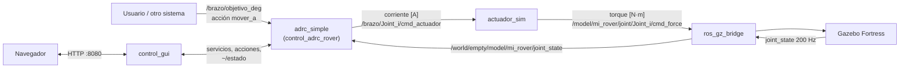

# ros2_ws_tesis

Workspace de ROS 2 de la tesis de maestría en Mecatrónica sobre el control de un rover móvil con brazo robótico de cinco grados de libertad. Contiene la descripción física del robot, su simulación en Gazebo y el controlador de posición del brazo basado en ADRC (*Active Disturbance Rejection Control*), diseñado para ejecutarse sin cambios de código tanto en simulación como en el robot real sobre una NVIDIA Jetson.

**Autor:** Ing. Adán Medina Covarrubias

| Plataforma | Versión |
|------------|---------|
| Sistema operativo | Ubuntu 22.04 (nativo, WSL o Jetson) |
| ROS 2 | Humble |
| Simulador | Gazebo Fortress (`ignition-gazebo6`) |
| Modelo dinámico | Pinocchio |

---

## Contenido

1. [Paquetes del workspace](#1-paquetes-del-workspace)
2. [Descripción del robot](#2-descripción-del-robot)
3. [Arquitectura del sistema](#3-arquitectura-del-sistema)
4. [Estructura del repositorio](#4-estructura-del-repositorio)
5. [Instalación](#5-instalación)
6. [Inicio rápido en simulación](#6-inicio-rápido-en-simulación)
7. [Otras formas de uso](#7-otras-formas-de-uso)
8. [Robot real](#8-robot-real)
9. [Documentación detallada](#9-documentación-detallada)
10. [Pendientes conocidos](#10-pendientes-conocidos)

---

## 1. Paquetes del workspace

| Paquete | Tipo | Estado | Función |
|---------|------|--------|---------|
| [`mi_rover_description`](src/mi_rover_description) | `ament_cmake` | Activo | URDF/xacro del rover y del brazo, mallas, Gazebo (con puente `ros_gz_bridge`, brazo parcialmente montado y masas escaladas) y RViz. |
| [`control_adrc_rover`](src/control_adrc_rover) | `ament_python` | **Principal** | Control GPI/ADRC para brazos seriales de hasta 5 articulaciones (activas, bloqueadas o ausentes), modelo dinámico reducido (Pinocchio), mando en corriente, protecciones, supervisor, autotuning y conformador. Lifecycle node configurable por perfil + plataforma. |
| [`control_adrc_interfaces`](src/control_adrc_interfaces) | `ament_cmake` | Nuevo | Mensaje de estado, servicios y acciones (MoverA, Autotune) del control. |
| [`control_adrc_gui`](src/control_adrc_gui) | `ament_python` | Nuevo | Interfaz web (sin dependencias nuevas) que usa sólo las interfaces públicas del control. |

La implementación anterior en C++ (`control_adrc_rover_cpp`) y el panel `test/rover_commander.py` se retiraron; siguen en el historial de git si se necesitan como referencia.

---

## 2. Descripción del robot

### Rover

- Chasis con cuatro ruedas y tracción diferencial (plugin `DiffDrive` de Gazebo): separación entre ruedas de 0.63 m y radio de 0.15 m. Recibe velocidades en `/cmd_vel`.
- IMU montada en el chasis que publica en `/imu_data` a 50 Hz.
- Coeficiente de fricción de las ruedas μ = 1.5.

### Brazo

El brazo se monta sobre el chasis mediante una unión fija (`chasis_a_brazo_joint`).

| Articulación | Función | Actuador | Tipo (URDF) | Par máx. [N·m] | Vel. máx. [rad/s] |
|:------------:|---------|----------|-------------|:--------------:|:-----------------:|
| J1 | Base giratoria | Yellow Jacket + tornillo sin fin | `continuous` | 33.6 | 1.23 |
| J2 | Hombro | Maxon EC 60 flat + GSW 62 A (100:1) | `continuous` | 37.0 | 3.67 |
| J3 | Codo | Maxon EC 60 flat + GSW 62 A (100:1) | `revolute` (±π) | 37.0 | 3.67 |
| J4 | Muñeca | Yellow Jacket + tornillo sin fin | `revolute` (±π) | 33.6 | 1.23 |
| J5 | Actuador final | Servomotor de rotación continua | `continuous` | 6.0 | 6.28 |

### Configuración de Gazebo

Definida en `rover_completo.urdf.xacro`:

- `JointStatePublisher` publica la posición de J1–J5 a **200 Hz**, la misma frecuencia del lazo de control. A frecuencias menores el retardo de la medición desestabiliza el observador.
- Un `ApplyJointForce` por articulación permite el mando en torque puro.
- El plugin propio `mi_rover_initial_pose` impone una sola vez la postura inicial (J1 = π, J2 = −π/2, J3 = J4 = 0 rad) sin aplicar fuerzas ni cerrar ningún lazo.

---

## 3. Arquitectura del sistema



En el robot real, la posición la publican los encoders o los drivers, `actuador_sim` no se ejecuta y la corriente se envía directamente a los drivers (`/arm_teleop/jointN/current`). El nodo de control es el mismo; sólo cambia la plataforma (`real.launch.py`, o `brazo.launch.py`, que detecta la Jetson).

---

## 4. Estructura del repositorio

```text
ros2_ws_tesis/
├── src/
│   ├── mi_rover_description/
│   │   ├── launch/gazebo.launch.py         Gazebo + puente (montadas, escala_masa)
│   │   ├── urdf/brazo.urdf                 Brazo (también lo usa el control)
│   │   ├── urdf/brazo_gz.urdf.xacro        Brazo para Gazebo (generado)
│   │   ├── urdf/rover_completo.urdf.xacro  Modelo maestro con plugins
│   │   └── scripts/generar_brazo_gz.py
│   ├── control_adrc_interfaces/            msg/srv/action del control
│   ├── control_adrc_rover/
│   │   ├── config/brazos/principal.yaml    Perfil del brazo
│   │   ├── config/plataformas/{sim,real}.yaml
│   │   ├── config/ajustes/                 Lo guardado desde la interfaz, por plataforma
│   │   ├── launch/brazo.launch.py          Control + actuador_sim + interfaz (detecta sim/real)
│   │   ├── launch/{sim,real}.launch.py     Plataforma fija
│   │   ├── launch/brazo_sim.launch.py      Compatibilidad
│   │   ├── control_adrc_rover/             Nodos y núcleo sin ROS (nucleo/)
│   │   ├── test/                           pytest + Monte Carlo
│   │   └── README.md                       Guía completa del control
│   └── control_adrc_gui/                   Interfaz web
└── README.md
```

---

## 5. Instalación

El repositorio es el propio workspace, por lo que se clona directamente como `~/ros2_ws`.

```bash
git clone https://github.com/adnavias/ros2_ws_tesis.git ~/ros2_ws
cd ~/ros2_ws
```

Instalar las dependencias del sistema:

```bash
sudo apt update
sudo apt install ros-humble-pinocchio ros-humble-ros-gz ros-humble-xacro \
                 ros-humble-joint-state-publisher-gui
```

Como alternativa, `rosdep` resuelve las dependencias declaradas en los `package.xml`:

```bash
sudo rosdep init   # solo si nunca se ha inicializado
rosdep update
rosdep install --from-paths src --ignore-src -y
```

Compilar, siempre desde la raíz del workspace:

```bash
source /opt/ros/humble/setup.bash
colcon build --symlink-install
source install/setup.bash
```

Con `--symlink-install`, los cambios en archivos YAML y Python surten efecto con solo relanzar, y lo que se guarda desde la interfaz queda en `src/` (visible para git). Solo es necesario recompilar al agregar archivos, modificar `setup.py`, `package.xml`, `CMakeLists.txt` o los `.msg/.srv/.action`.

Para no repetir los `source` en cada terminal, pueden agregarse al final de `~/.bashrc`.

---

## 6. Inicio rápido en simulación

**Terminal 1 — Gazebo (incluye el puente Gazebo ↔ ROS 2)**

```bash
ros2 launch mi_rover_description gazebo.launch.py
```

**Terminal 2 — Control, motores simulados e interfaz web**

```bash
ros2 launch control_adrc_rover sim.launch.py
```

Se abre el navegador en `http://localhost:8080`. El control está listo cuando aparece `Cero fijado en la postura actual: [...]` y `Control habilitado`.

**Objetivo desde la terminal**

```bash
ros2 topic pub --once /brazo/objetivo_deg std_msgs/msg/Float64MultiArray \
  "{data: [90.0, 30.0, -45.0, 0.0, 0.0]}"
```

Los ángulos son relativos a la postura de arranque; un valor extra fija el % de velocidad (o los segundos, si el modo de trayectoria es "tiempo"). Con sólo J1 montada: `montadas:=1` en ambos launch. Detalles en la [guía del control](src/control_adrc_rover/README.md).

---

## 7. Otras formas de uso

### Visualización en RViz

Muestra el modelo con controles deslizantes por articulación, sin simulación física:

```bash
ros2 launch mi_rover_description display.launch.py
```

### Movimiento del rover

Con el puente de `/cmd_vel` activo:

```bash
ros2 topic pub --once /cmd_vel geometry_msgs/msg/Twist \
  "{linear: {x: 0.3}, angular: {z: 0.0}}"
```

---

## 8. Robot real

La configuración del brazo real (tópicos `/arm_teleop/jointN/current`, signo de J1, encoders absolutos, ganancias, límites) está en `src/control_adrc_rover/config/plataformas/real.yaml`. En la Jetson:

```bash
ros2 launch control_adrc_rover real.launch.py              # brazo completo
ros2 launch control_adrc_rover real.launch.py montadas:=1  # sólo J1
```

La interfaz se abre desde la PC del rover en la dirección que imprime la terminal; ahí mismo se ajustan y guardan ganancias y plataforma (en `config/ajustes/principal_real.yaml`). El procedimiento y las reglas de seguridad están en las secciones 14 y 19 de la [guía](src/control_adrc_rover/README.md). **Ninguna configuración debe probarse en el robot sin haberse validado antes en simulación.**

---

## 9. Documentación detallada

[`src/control_adrc_rover/README.md`](src/control_adrc_rover/README.md) es la guía completa: interfaz ROS (tópicos, servicios, acciones, parámetros), interfaz web, configuración por capas, análisis de estabilidad (rango de κ), autotuning, supervisor, conformador, pruebas, solución de problemas y seguridad.

---

## 10. Pendientes conocidos

- El `package.xml` de `mi_rover_description` mantiene la licencia y la descripción como `TODO`.
- Algunos parámetros de los actuadores son supuestos y deben verificarse con datos medidos (relación del tornillo sin fin, inercia del rotor Yellow Jacket, corriente segura, posturas del autotuning). Ver la sección 20 de la guía.
- Las pruebas de estilo de ament (`test_flake8`, `test_pep257`) pueden reportar avisos de formato de docstrings; las pruebas funcionales están en `src/control_adrc_rover/test`.
