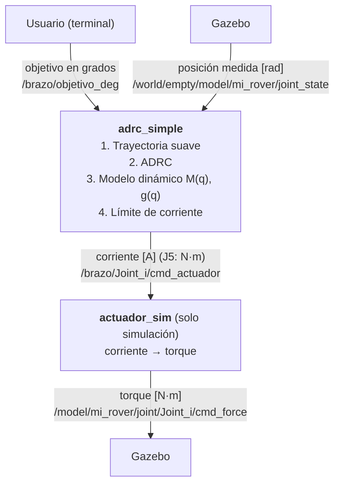

# control_adrc_rover

Control de posición basado en ADRC (*Active Disturbance Rejection Control*) para el brazo robótico de cinco grados de libertad del rover. Paquete para **ROS 2 Humble**, probado en simulación con **Gazebo Fortress** y preparado para su despliegue en una **NVIDIA Jetson**.

**Autor:** Ing. Adán Medina Covarrubias

Este paquete forma parte del workspace [`ros2_ws_tesis`](../../README.md), donde se describen el robot completo y los demás paquetes.

---

## Contenido

1. [Descripción general](#1-descripción-general)
2. [Conceptos básicos de ROS 2](#2-conceptos-básicos-de-ros-2)
3. [Arquitectura y flujo de información](#3-arquitectura-y-flujo-de-información)
4. [Estructura del repositorio](#4-estructura-del-repositorio)
5. [Instalación](#5-instalación)
6. [Ejecución en simulación](#6-ejecución-en-simulación)
7. [Envío de objetivos al brazo](#7-envío-de-objetivos-al-brazo)
8. [Interfaz ROS: entradas y salidas](#8-interfaz-ros-entradas-y-salidas)
9. [Descripción de los nodos y módulos](#9-descripción-de-los-nodos-y-módulos)
10. [Configuración](#10-configuración)
11. [Despliegue en el robot real (Jetson)](#11-despliegue-en-el-robot-real-jetson)
12. [Monitoreo y diagnóstico](#12-monitoreo-y-diagnóstico)
13. [Solución de problemas](#13-solución-de-problemas)
14. [Reglas de seguridad](#14-reglas-de-seguridad)
15. [Parámetros supuestos pendientes de verificar](#15-parámetros-supuestos-pendientes-de-verificar)
16. [Glosario](#16-glosario)

---

## 1. Descripción general

El brazo cuenta con cinco articulaciones:

| Articulación | Función          | Actuador                                              |
|:------------:|------------------|-------------------------------------------------------|
| J1           | Base giratoria   | Motor Yellow Jacket con tornillo sin fin              |
| J2           | Hombro           | Motor Maxon EC 60 flat con reductor GSW 62 A (100:1)  |
| J3           | Codo             | Motor Maxon EC 60 flat con reductor GSW 62 A (100:1)  |
| J4           | Muñeca           | Motor Yellow Jacket con tornillo sin fin              |
| J5           | Actuador final   | Servomotor de rotación continua                       |

El usuario indica una postura objetivo en grados y el sistema realiza, a 200 Hz, las siguientes tareas:

1. Genera una trayectoria suave entre la postura actual y la deseada, con velocidad y aceleración nulas en los extremos.
2. Lee de forma continua la posición medida de cada articulación.
3. Calcula, mediante un controlador ADRC, la corriente que requiere cada motor para seguir la trayectoria, compensando la gravedad, la inercia del brazo y la fricción.
4. Publica dichas corrientes para que los motores (o la simulación) las apliquen.

Un aspecto central del diseño es que **el controlador entrega corriente (A), no torque**. La corriente se limita en cada articulación para proteger los motores, incluso cuando el modelo del actuador no es exacto.

---

## 2. Conceptos básicos de ROS 2

Esta sección resume lo necesario para operar el paquete sin experiencia previa en ROS 2.

| Concepto      | Descripción |
|---------------|-------------|
| **Nodo**      | Programa que se ejecuta de forma independiente. Este paquete define dos: `adrc_simple` (controlador) y `actuador_sim` (exclusivo de simulación). |
| **Tópico**    | Canal de comunicación con nombre, por ejemplo `/brazo/objetivo_deg`. Un nodo publica en él y otros se suscriben. |
| **Mensaje**   | Dato que viaja por un tópico, con un tipo fijo, por ejemplo `std_msgs/Float64` o `sensor_msgs/JointState`. |
| **Parámetro** | Valor de configuración de un nodo (ganancias, límites, nombres de tópicos). Se lee al arrancar. |
| **YAML**      | Archivo de texto donde se definen los parámetros. Al modificarlo basta con relanzar el nodo. |
| **Launch**    | Archivo que arranca varios nodos simultáneamente con sus parámetros. |
| **Workspace** | Directorio `~/ros2_ws`; el código fuente reside en `~/ros2_ws/src`. `colcon build` lo instala para que ROS lo encuentre. |

Cada terminal nueva debe cargar el entorno de ROS y del workspace:

```bash
source /opt/ros/humble/setup.bash
source ~/ros2_ws/install/setup.bash
```

Sin este paso, los comandos `ros2` no localizan los paquetes.

---

## 3. Arquitectura y flujo de información

### Simulación (Gazebo)



### Robot real (Jetson)

La arquitectura es la misma, con dos diferencias:

- La posición la publican los encoders o los drivers de los motores, no Gazebo.
- El nodo `actuador_sim` no se ejecuta: la corriente se envía directamente a los drivers y el motor físico la convierte en torque.

El nodo de control es idéntico en ambos casos; únicamente cambia el archivo YAML de configuración.

---

## 4. Estructura del repositorio

```text
~/ros2_ws/src/
├── mi_rover_description/                Descripción física del robot
│   ├── urdf/brazo.urdf                  Geometría, masas, articulaciones y límites.
│   │                                    El controlador lo usa para construir su modelo.
│   ├── urdf/rover_completo.urdf.xacro   Rover, brazo y plugins de Gazebo
│   │                                    (posición publicada a 200 Hz).
│   ├── launch/gazebo.launch.py          Inicia Gazebo con el rover.
│   └── launch/display.launch.py         Inicia RViz (solo visualización).
│
└── control_adrc_rover/                  Controlador
    ├── config/brazo_adrc.yaml           Parámetros para simulación.
    ├── config/brazo_real.yaml           Parámetros para el robot real.
    ├── launch/brazo_sim.launch.py       Arranque del control con su YAML.
    ├── control_adrc_rover/
    │   ├── adrc_simple_node.py          Nodo principal del controlador.
    │   ├── trayectoria.py               Generación de trayectorias.
    │   ├── modelo_dinamico.py           Modelo dinámico del brazo (Pinocchio).
    │   └── actuador_sim_node.py         Modelo de los motores (solo Gazebo).
    ├── test/                            Pruebas de estilo (flake8, pep257, copyright).
    ├── setup.py
    └── package.xml
```

> **Nota:** para operar y ajustar el sistema solo es necesario editar los archivos YAML de `config/`. Los módulos de Python no requieren modificación.

---

## 5. Instalación

**Requisitos:** Ubuntu 22.04 con ROS 2 Humble (PC con WSL o Jetson).

**1. Instalar la biblioteca del modelo dinámico**

```bash
sudo apt update
sudo apt install ros-humble-pinocchio
```

**2. Compilar el workspace**

La compilación debe ejecutarse siempre desde `~/ros2_ws`, nunca dentro de `src`.

```bash
cd ~/ros2_ws
source /opt/ros/humble/setup.bash
colcon build --symlink-install
source install/setup.bash
```

La opción `--symlink-install` permite editar los archivos YAML y de Python sin recompilar; basta con relanzar. Solo es necesario recompilar al agregar archivos nuevos o modificar `setup.py` o `package.xml`.

**3. (Opcional) Cargar el entorno automáticamente**

Agregar al final de `~/.bashrc`:

```bash
source /opt/ros/humble/setup.bash
source ~/ros2_ws/install/setup.bash
```

---

## 6. Ejecución en simulación

Se requieren cuatro terminales, cada una con el entorno cargado.

**Terminal 1 — Simulador**

```bash
ros2 launch mi_rover_description gazebo.launch.py
```

El brazo aparece en su postura inicial, extendido hacia adelante.

**Terminal 2 — Puente Gazebo ↔ ROS 2**

La posición de las articulaciones y los comandos de fuerza se intercambian entre Gazebo y ROS mediante `ros_gz_bridge`. `gazebo.launch.py` no inicia el puente, por lo que debe lanzarse en otra terminal (Gazebo Fortress):

```bash
ros2 run ros_gz_bridge parameter_bridge \
  "/world/empty/model/mi_rover/joint_state@sensor_msgs/msg/JointState[ignition.msgs.Model" \
  "/model/mi_rover/joint/Joint_1/cmd_force@std_msgs/msg/Float64]ignition.msgs.Double" \
  "/model/mi_rover/joint/Joint_2/cmd_force@std_msgs/msg/Float64]ignition.msgs.Double" \
  "/model/mi_rover/joint/Joint_3/cmd_force@std_msgs/msg/Float64]ignition.msgs.Double" \
  "/model/mi_rover/joint/Joint_4/cmd_force@std_msgs/msg/Float64]ignition.msgs.Double" \
  "/model/mi_rover/joint/Joint_5/cmd_force@std_msgs/msg/Float64]ignition.msgs.Double"
```

**Terminal 3 — Controlador**

```bash
ros2 launch control_adrc_rover brazo_sim.launch.py
```

Este comando inicia `adrc_simple` y `actuador_sim` con `config/brazo_adrc.yaml`. Deben aparecer los siguientes mensajes:

```text
Modelo dinámico cargado: .../brazo.urdf
Interfaz: estado <- ... | mando (...) -> ...
ADRC listo a 200 Hz | modo_inercia=completa | ...
Cero fijado en la postura actual: [...] rad
```

El último mensaje confirma que el controlador está recibiendo la posición del brazo.

**Terminal 4 — Envío de objetivos** (ver [sección 7](#7-envío-de-objetivos-al-brazo)).

Para detener el sistema, presionar `Ctrl+C` en cada terminal, primero en la del controlador y después en la de Gazebo.

> **Importante — referencia cero.** Al arrancar, la postura actual del brazo se toma como `(0, 0, 0, 0, 0)`. Todos los ángulos enviados son relativos a esa postura. Si el controlador se reinicia con el brazo en otra posición, la referencia cambia.

---

## 7. Envío de objetivos al brazo

### 7.1 Comando principal (grados)

```bash
ros2 topic pub --once /brazo/objetivo_deg std_msgs/msg/Float64MultiArray "{data: [J1, J2, J3, J4, J5]}"
```

Ejemplo: girar la base 90°, elevar el hombro 30° y flexionar el codo −45°:

```bash
ros2 topic pub --once /brazo/objetivo_deg std_msgs/msg/Float64MultiArray "{data: [90.0, 30.0, -45.0, 0.0, 0.0]}"
```

Regresar a la postura inicial:

```bash
ros2 topic pub --once /brazo/objetivo_deg std_msgs/msg/Float64MultiArray "{data: [0.0, 0.0, 0.0, 0.0, 0.0]}"
```

Consideraciones:

- Todos los valores deben escribirse con punto decimal (`90.0`, no `90`).
- La opción `--once` envía el mensaje una sola vez. Sin ella, el mensaje se repite y el brazo replanifica de forma continua.
- Los ángulos son relativos a la postura de arranque.

### 7.2 Velocidad (sexto valor, en porcentaje)

```bash
ros2 topic pub --once /brazo/objetivo_deg std_msgs/msg/Float64MultiArray "{data: [0.0, 135.0, -135.0, 0.0, 0.0, 20.0]}"
```

- El sexto valor es el porcentaje de velocidad; en el ejemplo, 20 %.
- El rango admitido es de 1 % a 200 %. Si se omite, se usa `velocidad_pct_defecto` (50 % por defecto).
- El 100 % corresponde a la mitad de la velocidad física de los motores; el 200 %, a la velocidad física máxima.
- La duración se calcula automáticamente para que todas las articulaciones lleguen al mismo tiempo.
- Si el movimiento requiriera más corriente de la permitida (situación típica con el brazo extendido), el sistema lo ralentiza y lo notifica con el mensaje *"alargada para no exceder la corriente"*.

### 7.3 Mover solo algunas articulaciones

Las articulaciones marcadas con `.nan` conservan su objetivo actual:

```bash
ros2 topic pub --once /brazo/objetivo_deg std_msgs/msg/Float64MultiArray "{data: [.nan, 45.0, .nan, .nan, .nan]}"
```

### 7.4 Cambio de objetivo durante un movimiento

Es posible enviar un nuevo objetivo mientras el brazo está en movimiento. La nueva trayectoria parte del estado actual de movimiento, sin discontinuidades.

### 7.5 Entrada alternativa en radianes

Se conserva por compatibilidad. Admite un subconjunto de articulaciones y utiliza la velocidad por defecto:

```bash
ros2 topic pub --once /target_joint_states sensor_msgs/msg/JointState "{name: ['Joint_2'], position: [0.5]}"
```

### 7.6 Cambiar la velocidad por defecto en ejecución

```bash
ros2 param set /adrc_simple velocidad_pct_defecto 30.0
```

---

## 8. Interfaz ROS: entradas y salidas

### Entradas del nodo `adrc_simple`

| Tópico (por defecto)                       | Tipo                     | Unidades | Descripción |
|--------------------------------------------|--------------------------|----------|-------------|
| `/brazo/objetivo_deg`                      | `std_msgs/Float64MultiArray` | grados (+ %) | `data = [J1, J2, J3, J4, J5 (, %vel)]` |
| `/target_joint_states`                     | `sensor_msgs/JointState` | rad      | Entrada alternativa de objetivos. |
| `/world/empty/model/mi_rover/joint_state`  | `sensor_msgs/JointState` | rad      | Posición medida. En el robot real la publican los encoders. |

### Salidas del nodo `adrc_simple`

| Tópico (por defecto)                                  | Tipo               | Unidades |
|-------------------------------------------------------|--------------------|----------|
| `/brazo/Joint_1/cmd_actuador` … `/brazo/Joint_4/cmd_actuador` | `std_msgs/Float64` | A        |
| `/brazo/Joint_5/cmd_actuador`                         | `std_msgs/Float64` | N·m      |

El servomotor de J5 no admite control de corriente, por lo que recibe un comando de torque.

El formato de salida es configurable ([sección 10.1](#101-interfaz-ros)): un mensaje por articulación, un único arreglo o un `JointState` con el campo `effort`.

### Nodo `actuador_sim` (solo simulación)

- **Entrada:** las corrientes publicadas por `adrc_simple`.
- **Salida:** `/model/mi_rover/joint/Joint_i/cmd_force` (`std_msgs/Float64`, N·m) hacia Gazebo.

### Diagnóstico (opcional)

`/adrc_simple/error_deg/Joint_i`, `/adrc_simple/state` y `/adrc_simple/reference` (ver [sección 12](#12-monitoreo-y-diagnóstico)).

Todos los nombres de tópicos se definen en el YAML; ninguno está fijo en el código.

---

## 9. Descripción de los nodos y módulos

### `adrc_simple_node.py` — controlador (nodo `adrc_simple`)

En cada ciclo de 5 ms (200 Hz):

1. Lee la posición medida de las cinco articulaciones.
2. Evalúa la trayectoria de referencia: posición, velocidad y aceleración deseadas en el instante actual.
3. Calcula, mediante el ADRC, la aceleración requerida a partir del error de seguimiento. La componente de estimación compensa en línea los efectos no modelados: fricción, impactos, errores del modelo y carga adicional.
4. Convierte esa aceleración en torque con el modelo dinámico (Pinocchio), empleando la matriz de inercia completa M(q) —que incluye los acoplamientos entre articulaciones— y añade el torque de compensación gravitacional g(q).
5. Divide el torque entre la constante de par del motor para obtener la corriente, suma la compensación de fricción interna del motor y satura el resultado al límite de cada actuador.
6. Publica las corrientes.

Al recibir un objetivo nuevo, planifica la trayectoria y verifica que la corriente requerida se mantenga dentro de los límites; en caso contrario, extiende su duración.

### `trayectoria.py` — generación de trayectorias

Utiliza polinomios de quinto grado (mínimo *jerk*) con velocidad y aceleración nulas en los extremos. La duración se calcula a partir de la velocidad y aceleración máximas de cada articulación y se escala con el porcentaje de velocidad solicitado.

### `modelo_dinamico.py` — modelo dinámico

Lee `brazo.urdf` y calcula, para cada postura, la matriz de inercia M(q) y el vector de torques gravitacionales g(q). Emplea la misma descripción del robot que Gazebo.

### `actuador_sim_node.py` — modelo de los motores (nodo `actuador_sim`)

Solo se usa en simulación. Dado que Gazebo no admite comandos de corriente, este nodo reproduce el comportamiento del motor real:

$$\tau = K_\tau\,(i - i_0)$$

Si deja de recibir comandos durante 0.1 s, aplica torque cero como medida de seguridad. No se ejecuta en el robot real.

### `brazo_sim.launch.py` — arranque

| Argumento                 | Efecto |
|---------------------------|--------|
| `sim:=true` (por defecto) | Carga `brazo_adrc.yaml` y lanza `adrc_simple` y `actuador_sim`. |
| `sim:=false`              | Carga `brazo_real.yaml` y lanza únicamente `adrc_simple`. |
| `params_file:=/ruta.yaml` | Utiliza un archivo de parámetros distinto. |

---

## 10. Configuración

Los archivos `config/brazo_adrc.yaml` (simulación) y `config/brazo_real.yaml` (robot real) comparten la misma estructura.

**Reglas de formato:**

- Los arreglos contienen siempre cinco valores, en el orden `[J1, J2, J3, J4, J5]`.
- Los valores numéricos se escriben con punto decimal (`5.0`, no `5`). ROS 2 rechaza un entero donde espera un valor de punto flotante y el nodo no arranca.
- La indentación se hace con espacios, no con tabuladores.
- El texto posterior a `#` es comentario.
- Tras modificar el archivo, detener el controlador con `Ctrl+C` y relanzarlo. Con `--symlink-install` no es necesario recompilar.

El archivo se organiza en tres bloques:

| Bloque          | Contenido |
|-----------------|-----------|
| `/**:`          | Parámetros compartidos por todos los nodos (interfaz de mando). |
| `actuador_sim:` | Parámetros del modelo de motores. |
| `adrc_simple:`  | Parámetros del controlador. |

### 10.1 Interfaz ROS

Es el grupo de parámetros que debe ajustarse al pasar a la Jetson.

| Parámetro               | Descripción |
|-------------------------|-------------|
| `nombres_urdf`          | Nombres de las articulaciones en `brazo.urdf`. Solo se modifica si cambia el URDF. |
| `tipo_mando`            | Formato de salida: `"float64_por_articulacion"` (un `Float64` por articulación en `topicos_mando`), `"float64_multiarray"` (un arreglo `[J1..J5]` en `topico_mando_unico`) o `"joint_state"` (un `JointState`, campo `effort`, en `topico_mando_unico` con `nombres_en_mando`). |
| `topicos_mando`         | Los cinco tópicos de salida (primer formato). |
| `topico_mando_unico`    | Tópico de salida (formatos segundo y tercero). |
| `nombres_en_mando`      | Nombres de articulación que espera el driver (tercer formato). |
| `topicos_fuerza`        | (`actuador_sim`) Tópicos de torque hacia Gazebo. |
| `topico_estado`         | Tópico del que se lee la posición medida (`JointState`). |
| `nombres_en_estado`     | Nombre de cada articulación dentro del mensaje de estado, en orden J1..J5. Las articulaciones adicionales (ruedas, etc.) se ignoran. |
| `qos_estado_best_effort`| `true` si el publicador de posición usa QoS *best effort* (habitual con micro-ROS). Conviene probarlo si nunca aparece *"Cero fijado"*. |
| `signo_articulacion`    | `1.0` por defecto; `-1.0` si el motor o el encoder giran en sentido opuesto al URDF. Invierte tanto la medición como el mando. |
| `topico_objetivo_deg`   | Entrada de objetivos en grados (`""` la desactiva). |
| `topico_objetivo_rad`   | Entrada de objetivos en radianes (`""` la desactiva). |

### 10.2 Lazo de control y referencia cero

| Parámetro                     | Descripción |
|-------------------------------|-------------|
| `frecuencia_control`          | 200.0 Hz. No debe reducirse; la medición debe llegar a la misma frecuencia. |
| `cero_desde_primera_medicion` | `true`: la referencia cero es la postura al arrancar. `false`: se usa `offsets_cero` [rad]. |
| `medicion_absoluta`           | `true` si la posición llega en la convención del URDF (Gazebo o encoders absolutos). `false` con encoders incrementales (leen cero al encender); en ese caso el modelo usa `q_modelo = q_medida + postura_encendido_urdf`. |
| `postura_encendido_urdf`      | Postura física del brazo al encender [rad], en convención URDF. Solo aplica con `medicion_absoluta: false` y es indispensable para que el modelo conozca la dirección de la gravedad. |

### 10.3 Ganancias del ADRC

| Parámetro | Descripción |
|-----------|-------------|
| `wn`      | Frecuencia natural del lazo [rad/s]. Valores mayores dan una respuesta más rígida y rápida, a costa de mayor sensibilidad al ruido y a los retardos. |
| `eps`     | Separación entre el lazo y el estimador, que opera a `wn/eps`. Valores menores rechazan perturbaciones más rápido, pero exigen una medición más rápida. Debe cumplirse `(wn/eps)/frecuencia < 0.5`; de lo contrario, el nodo emite un aviso al arrancar. |
| `zeta`    | Factor de amortiguamiento. `1.0` corresponde teóricamente a una respuesta sin sobreimpulso; valores mayores dan una respuesta más suave y lenta, y valores menores, una más rápida con posible sobreimpulso. |

Valores actuales, seleccionados mediante comparación de variantes en simulación:

| Parámetro | `brazo_adrc.yaml` (simulación) | `brazo_real.yaml` (robot real) |
|-----------|--------------------------------|--------------------------------|
| `wn`      | `[10.0, 10.0, 15.0, 15.0, 1.0]` | `[10.0, 10.0, 10.0, 10.0, 1.0]` |
| `eps`     | `[0.2, 0.2, 0.2, 0.2, 0.2]`     | `[0.2, 0.2, 0.2, 0.2, 0.2]`     |
| `zeta`    | `[1.5, 1.0, 1.0, 1.5, 1.0]`     | `[1.5, 1.0, 1.0, 1.5, 1.0]`     |

Se recomienda modificar un solo parámetro a la vez y en pasos de ±20 %.

### 10.4 Modelo del brazo

| Parámetro                 | Descripción |
|---------------------------|-------------|
| `modo_inercia`            | `"completa"` (recomendado): M(q) con acoplamientos. `"diagonal"`: solo la diagonal de M(q). `"constante"`: inercia fija `inercia_constante`. Si Pinocchio no está disponible, se usa `"constante"`. |
| `usar_modelo`             | Articulaciones que emplean el modelo (J5 no lo usa). |
| `inercia_constante`       | [kg·m²] Para el modo `"constante"` y para J5. |
| `armadura`                | Inercia de los rotores reflejada en la articulación [kg·m²]. Vale `0.0` en simulación, ya que Gazebo no la modela; los valores reales están en `brazo_real.yaml`. |
| `urdf_brazo`              | Ruta al URDF (`""` usa el de `mi_rover_description`). |
| `feedforward_gravedad`    | `true`: añade el torque de compensación gravitacional. |
| `feedforward_aceleracion` | `true`: utiliza la aceleración de la trayectoria de referencia. |

### 10.5 Motores y límites de corriente

| Parámetro                      | Descripción |
|--------------------------------|-------------|
| `k_tau_hat`                    | Constante de par estimada, reflejada en la articulación [N·m/A]. No requiere ser exacta; el ADRC compensa la discrepancia. |
| `limite_mando`                 | Corriente máxima [A] (J5: N·m). **Protege los motores.** Maxon: 7.35 A (protege motor y reductor). Yellow Jacket: 6.54 A en simulación y 2.5 A en el robot real, para limitar el calentamiento. |
| `corriente_vacio`              | Corriente consumida para vencer la fricción interna del motor [A]; se compensa automáticamente. |
| `ancho_comp_friccion`          | Suavizado de la compensación de fricción [A]. No se recomienda modificarlo. |
| `margen_corriente_trayectoria` | `0.9`: ninguna trayectoria puede requerir más del 90 % del límite; si lo hace, se ralentiza. |

### 10.6 Trayectoria y velocidad

| Parámetro               | Descripción |
|-------------------------|-------------|
| `v_max_fisica`          | Velocidad máxima real de cada articulación [rad/s]. |
| `a_max_100pct`          | Aceleración permitida al 100 % [rad/s²]. |
| `factor_100pct`         | `0.5`: el 100 % equivale a la mitad de `v_max_fisica` y el 200 %, al máximo físico. |
| `velocidad_pct_defecto` | Porcentaje utilizado cuando el comando no incluye el sexto valor. |
| `velocidad_pct_min`     | Porcentaje mínimo permitido. |
| `duracion_minima`       | Duración mínima de cualquier movimiento [s]. |

### 10.7 Diagnóstico

| Parámetro              | Descripción |
|------------------------|-------------|
| `publicar_diagnostico` | `true`: publica error, estado y referencia para graficar. |
| `periodo_log`          | Intervalo de impresión del resumen en la terminal [s] (`0.0` lo desactiva; `0.5` es un valor práctico). |

---

## 11. Despliegue en el robot real (Jetson)

1. Clonar o actualizar el repositorio en la Jetson, instalar Pinocchio y compilar ([sección 5](#5-instalación)).

2. Con los drivers de los motores en funcionamiento, identificar los tópicos y nombres disponibles:

   ```bash
   ros2 topic list
   ros2 topic info -v <tópico>        # tipo de mensaje y QoS
   ros2 topic echo --once <tópico>    # nombres de las articulaciones
   ```

3. Editar `config/brazo_real.yaml`, modificando únicamente las líneas marcadas con `# <-- AJUSTAR`: `topico_estado`, `nombres_en_estado`, `qos_estado_best_effort`, `signo_articulacion`, `tipo_mando` y los tópicos o nombres del mando. Con encoders incrementales, establecer además `medicion_absoluta: false` y `postura_encendido_urdf` con la postura real al encender.

4. Verificar que la posición se reciba a aproximadamente 200 Hz:

   ```bash
   ros2 topic hz <topico_estado>
   ```

5. Lanzar el controlador sin el modelo de motores:

   ```bash
   ros2 launch control_adrc_rover brazo_sim.launch.py sim:=false
   ```

6. Realizar la primera prueba con el brazo sin carga, al 10 % de velocidad y con movimientos pequeños de una articulación a la vez ([sección 14](#14-reglas-de-seguridad)).

---

## 12. Monitoreo y diagnóstico

Corriente enviada a una articulación:

```bash
ros2 topic echo /brazo/Joint_2/cmd_actuador
```

Posición medida:

```bash
ros2 topic echo /world/empty/model/mi_rover/joint_state
```

Frecuencia de llegada de la posición (debe ser cercana a 200 Hz):

```bash
ros2 topic hz /world/empty/model/mi_rover/joint_state
```

Parámetros con los que se ejecuta el controlador:

```bash
ros2 param dump /adrc_simple
```

**Resumen en terminal.** Con `periodo_log: 0.5`, el nodo imprime cada 0.5 s la referencia q\*, la posición q, el error e (en grados) y la corriente i.

**Gráficas.** Con `publicar_diagnostico: true`, tras relanzar:

```bash
ros2 run rqt_plot rqt_plot /adrc_simple/error_deg/Joint_2/data
```

Muestra el error en grados de J2; basta con sustituir `Joint_2` por la articulación de interés.

---

## 13. Solución de problemas

<details>
<summary><b>El controlador arranca, pero nunca muestra "Cero fijado…" y el brazo no responde</b></summary>

La posición medida no está llegando.

- Verificar con `ros2 topic hz` el `topico_estado` configurado en el YAML.
- Si aparece el aviso *"no encuentro [...] Nombres recibidos: [...]"*, copiar esos nombres en `nombres_en_estado`.
- En el robot real, probar `qos_estado_best_effort: true`.
- En simulación, comprobar que `ros_gz_bridge` esté en ejecución.
</details>

<details>
<summary><b>El brazo oscila o se vuelve inestable</b></summary>

- Comprobar que la posición llegue a ~200 Hz; a 50 Hz el lazo se vuelve inestable. En Gazebo, revisar `update_rate` 200 del `JointStatePublisher` en `rover_completo.urdf.xacro`.
- En el robot real, una articulación con el signo invertido diverge en cuanto se mueve; revisar `signo_articulacion`.
- Verificar que no se esté ejecutando simultáneamente el controlador anterior en C++ (`control_adrc_rover_cpp`), que publica torque en las mismas articulaciones.
</details>

<details>
<summary><b>El movimiento es demasiado lento</b></summary>

- Aumentar el porcentaje de velocidad (sexto valor) o `velocidad_pct_defecto`.
- Si el registro indica *"alargada para no exceder la corriente"*, el motor ha alcanzado su capacidad en esa postura. Es el caso típico del hombro con el brazo extendido hacia adelante, donde el par disponible está casi agotado. Se trata de un límite físico.
</details>

<details>
<summary><b>El nodo no arranca y el error menciona un parámetro</b></summary>

En la mayoría de los casos se debe a un número sin punto decimal (`5` en lugar de `5.0`) o a un arreglo que no contiene cinco valores.
</details>

<details>
<summary><b>"No se pudo cargar el modelo (Pinocchio/URDF)"</b></summary>

Instalar `ros-humble-pinocchio`. Mientras tanto, el controlador opera en modo `"constante"`, con menor desempeño cuando el brazo está extendido.
</details>

<details>
<summary><b>Se envió un objetivo y el brazo no se movió</b></summary>

- Confirmar el nombre del tópico y que todos los valores tengan punto decimal.
- Confirmar que el mensaje contenga cinco (o seis) valores.
- Recordar que el objetivo es relativo a la postura de arranque.
</details>

<details>
<summary><b><code>colcon build</code> falla con "Could not create symlink ... log"</b></summary>

La compilación se ejecutó dentro de un directorio de `src`. Eliminar los directorios `build/`, `install/` y `log/` que hayan quedado dentro de `src` y compilar siempre desde `~/ros2_ws`.
</details>

---

## 14. Reglas de seguridad

Aplicables a toda prueba en el robot real:

1. **Validar primero en simulación.** Ninguna configuración se prueba en el robot sin haber funcionado antes en Gazebo con el mismo YAML (exceptuando los parámetros de interfaz).
2. Mantener al alcance un paro de emergencia físico y utilizar una fuente con límite de corriente.
3. Realizar las primeras pruebas sin carga, al 10 % de velocidad, con movimientos de 5° a 10° y una articulación a la vez (usando `.nan` en las demás).
4. Verificar el sentido de giro de cada motor **antes** de cerrar el lazo.
5. Configurar también el límite de corriente en el driver de cada motor. El límite por software no sustituye al de hardware.
6. No ajustar `limite_mando` por encima de la corriente continua del motor (Maxon: 9.34 A) ni del par continuo del reductor (27 N·m).
7. Si el brazo no está en reposo al arrancar el controlador, detener el sistema: la referencia cero se fija con la primera medición.

---

## 15. Parámetros supuestos pendientes de verificar

| Parámetro | Valor supuesto |
|-----------|----------------|
| Tornillo sin fin de J1 y J4 | Relación 10:1, eficiencia 0.5; caja Yellow Jacket 50.9:1. |
| Inercia del rotor Yellow Jacket | 3 × 10⁻⁶ kg·m² (afecta `armadura` en `brazo_real.yaml`). |
| Corriente segura Yellow Jacket | 2.5 A en el robot real (corriente de bloqueo: 9.2 A). |
| J5 (servomotor) | Sin modelo; control en torque con límite de 2 N·m. |

Cuando se disponga de datos medidos, deben actualizarse en el YAML (`k_tau_hat`, `armadura`, `limite_mando`) y en `actuador_sim_node.py` (parámetros físicos de la simulación).

---

## 16. Glosario

| Término | Definición |
|---------|------------|
| **ADRC** | *Active Disturbance Rejection Control*. Estrategia de control que estima en línea las perturbaciones totales que afectan al sistema y las cancela. |
| **GPI** | Variante del ADRC empleada en este paquete (Sira-Ramírez), que compensa mediante integrales del error en lugar de un observador explícito. |
| **Observador** | Componente del controlador que estima las variables no medidas (perturbaciones, fricción, errores de modelo). |
| **M(q)** | Matriz de inercia: describe la dificultad de acelerar cada articulación en la postura q y el acoplamiento entre ellas. |
| **g(q)** | Vector de torques gravitacionales en la postura q. |
| **Inversión de la ganancia de entrada** | Uso del modelo para convertir la aceleración deseada en corriente: i = K⁻¹ (M(q)·v + g(q)). |
| **Armadura** | Inercia del rotor multiplicada por el cuadrado de la relación de reducción; en el robot real es considerable. |
| **K_τ** | Constante de par: N·m de salida por ampere. |
| **i₀** | Corriente en vacío: la necesaria para vencer la fricción interna del motor. |
| **Feedforward** | Componente del mando calculada a priori (gravedad, aceleración de referencia) que reduce el esfuerzo de corrección del lazo. |
| **Trayectoria quíntica** | Polinomio de quinto grado con velocidad y aceleración nulas en los extremos. |
| **Saturación** | Recorte del mando cuando la corriente solicitada excede el límite permitido. |
| **QoS** | Calidad de servicio de un tópico en ROS 2 (*reliable* o *best effort*). Publicador y suscriptor deben ser compatibles. |
| **rad / °** | 1 rad ≈ 57.3°. ROS trabaja internamente en radianes; los objetivos se envían en grados. |
